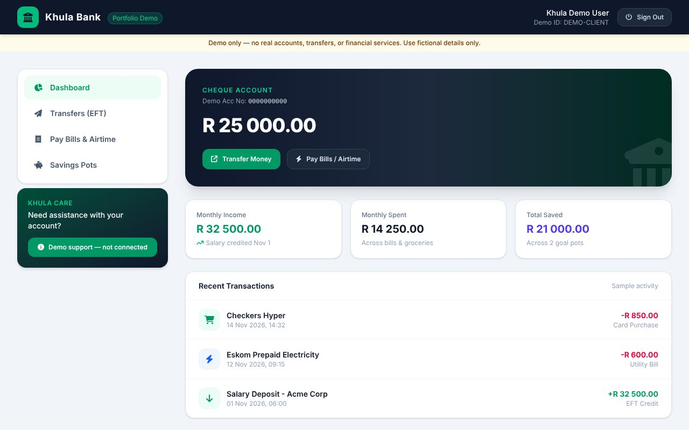

# Khula Bank

A responsive South African online-banking dashboard, built as a portfolio demo with HTML, Tailwind CSS and vanilla JavaScript.

**Live demo: [ukhezo.github.io/Khula-bank](https://ukhezo.github.io/Khula-bank/)**



> **Demo only.** Khula Bank is not a real bank or financial service. All balances, transactions and savings goals are fictional sample data, no money moves, and no banking back end is connected. Use fictional details only.

## Demo sign-in

| Field     | Value         |
|-----------|---------------|
| Client ID | `DEMO-CLIENT` |
| PIN       | `00000`       |

## Features

- **Dashboard:** account balance, monthly income, monthly spending and total savings, all of which update live as you use the app.
- **EFT transfers:** choose a South African bank, enter a beneficiary and account number, and send money. The account number is validated and transfers are blocked if there isn't enough money.
- **Prepaid and bills:** buy airtime or data (Vodacom, MTN, Cell C, Telkom), prepaid electricity (generates a demo 20-digit token) or pay a municipal water account, with input checks for each type.
- **Savings pots:** create new goal pots, move money into them and watch the progress bars fill.
- **Transaction history:** every action adds a dated entry with its own icon.
- **Friendly feedback:** success and error messages appear as on-screen toasts instead of browser pop-ups.
- **Consistent rand formatting:** amounts are shown South African style, e.g. `R 25 000.00`.
- **Responsive and accessible:** works from 320px phones up to desktops, with labelled form fields, ARIA progress bars and keyboard-friendly controls.

## Built with

- HTML5
- [Tailwind CSS v4](https://tailwindcss.com/) (pre-built into `css/styles.css`)
- Vanilla JavaScript (DOM updates, form validation, state for balance, spending and pots)
- [Font Awesome](https://fontawesome.com/) icons

## Run it locally

1. Clone the repository:
   ```bash
   git clone https://github.com/Ukhezo/Khula-bank.git
   ```
2. Open `index.html` in your browser and sign in with the demo details above.

### Rebuilding the CSS (only if you change Tailwind classes)

```bash
npm install tailwindcss @tailwindcss/cli
echo '@import "tailwindcss" source(none); @source "./index.html";' > input.css
npx @tailwindcss/cli -i input.css -o css/styles.css --minify
```

## Project structure

```
Khula-bank/
├── index.html          # Markup and app logic
├── css/
│   └── styles.css      # Compiled Tailwind CSS
├── images/
│   └── screenshot.jpg  # README screenshot
├── LICENSE
└── README.md
```

## Possible next steps

- Save balances and pots between visits with `localStorage`
- Add spending charts by category
- Connect to a mock REST API to practise async data loading

## License

[MIT](LICENSE) © 2026 Ukhezo
